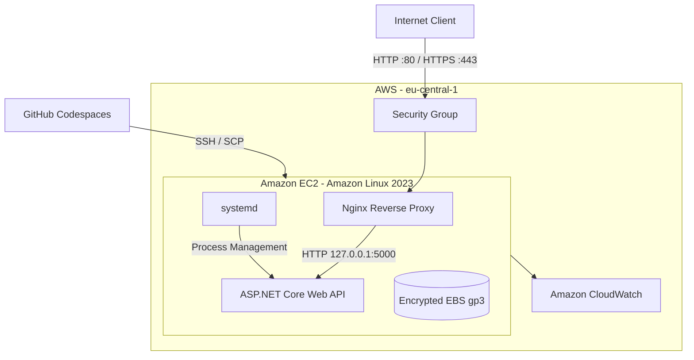

# AWS EC2 — Secure Application Server

## Overview

A hands-on cloud computing project demonstrating the deployment, configuration, security, monitoring, and lifecycle management of an ASP.NET Core Web API on Amazon EC2.

## Architecture



## Technology Stack

| Component | Technology |
|---|---|
| Cloud Provider | Amazon Web Services |
| Compute | Amazon EC2 — t3.micro |
| Operating System | Amazon Linux 2023 |
| Application | ASP.NET Core Web API (.NET 8) |
| Reverse Proxy | Nginx |
| Process Management | systemd |
| Storage | Encrypted Amazon EBS gp3 — 10 GiB |
| Network Security | AWS Security Groups |
| Transport Encryption | TLS 1.2 / TLS 1.3 |
| Monitoring | Amazon CloudWatch |
| Development Environment | GitHub Codespaces |

## Implementation

1. Provisioned an Amazon EC2 instance.
2. Configured SSH access using an RSA key pair and restricted inbound rules.
3. Installed the ASP.NET Core runtime.
4. Developed and published a Web API using GitHub Codespaces.
5. Transferred application artifacts to EC2 using SCP.
6. Configured systemd for automatic application startup and restart on failure.
7. Configured Nginx as a reverse proxy.
8. Enabled HTTPS using a self-signed TLS certificate.
9. Configured HTTP-to-HTTPS redirection.
10. Monitored infrastructure metrics using Amazon CloudWatch.
11. Validated application availability after an instance reboot.
12. Removed provisioned AWS resources after testing.

## Security Configuration

| Port | Protocol | Access |
|---|---|---|
| 22 | SSH | Restricted source IP addresses |
| 80 | HTTP | Public — redirects to HTTPS |
| 443 | HTTPS | Public |
| 5000 | Application HTTP | Localhost only |

Additional security measures:

- Encrypted EBS storage.
- SSH key-based authentication.
- Restricted private key permissions.
- Application execution under a non-root user.
- TLS termination at the reverse proxy.
- Exclusion of private keys and sensitive files from version control.

## Monitoring

Amazon CloudWatch was used to observe:

- CPU utilization
- CPU credit usage and balance
- Network traffic
- Network packet activity

## Validation Results

| Test | Result |
|---|---|
| SSH connectivity | Passed |
| Application deployment | Passed |
| systemd service startup | Passed |
| Nginx reverse proxy | Passed |
| External API accessibility | Passed |
| HTTP-to-HTTPS redirection | Passed |
| HTTPS connectivity | Passed |
| Application availability after reboot | Passed |
| AWS resource cleanup | Completed |

## Repository Structure

```text
aws-ec2-secure-application-server/
├── src/
│   └── WebApi/
├── deployment/
│   ├── nginx.conf
│   └── webapi.service
├── .gitignore
└── README.md
```

## Resource Lifecycle Management

All project-specific AWS resources were removed after validation:

- EC2 instance
- EBS volume
- Automatically assigned public IPv4 address
- Security group
- EC2 key pair

The SSH private key was also removed from GitHub Codespaces.

## Limitations

This project is an educational proof of concept, not a production-ready architecture.

- The TLS certificate is self-signed and is not trusted by public certificate authorities.
- The application uses .NET 8, which has reached end of support.
- The architecture uses a single EC2 instance without high availability or automatic scaling.
- The application endpoint is publicly accessible without application-level authentication.
- The deployment configuration requires environment-specific values and certificate provisioning.

## Key Learning Outcomes

- EC2 provisioning and lifecycle management
- Linux server administration
- SSH authentication and network security
- ASP.NET Core application deployment
- Reverse proxy architecture
- TLS termination
- Linux process management
- Infrastructure monitoring
- Cloud resource cleanup and cost awareness

## Project Status

**Completed — infrastructure deployed, tested, documented, and decommissioned.**